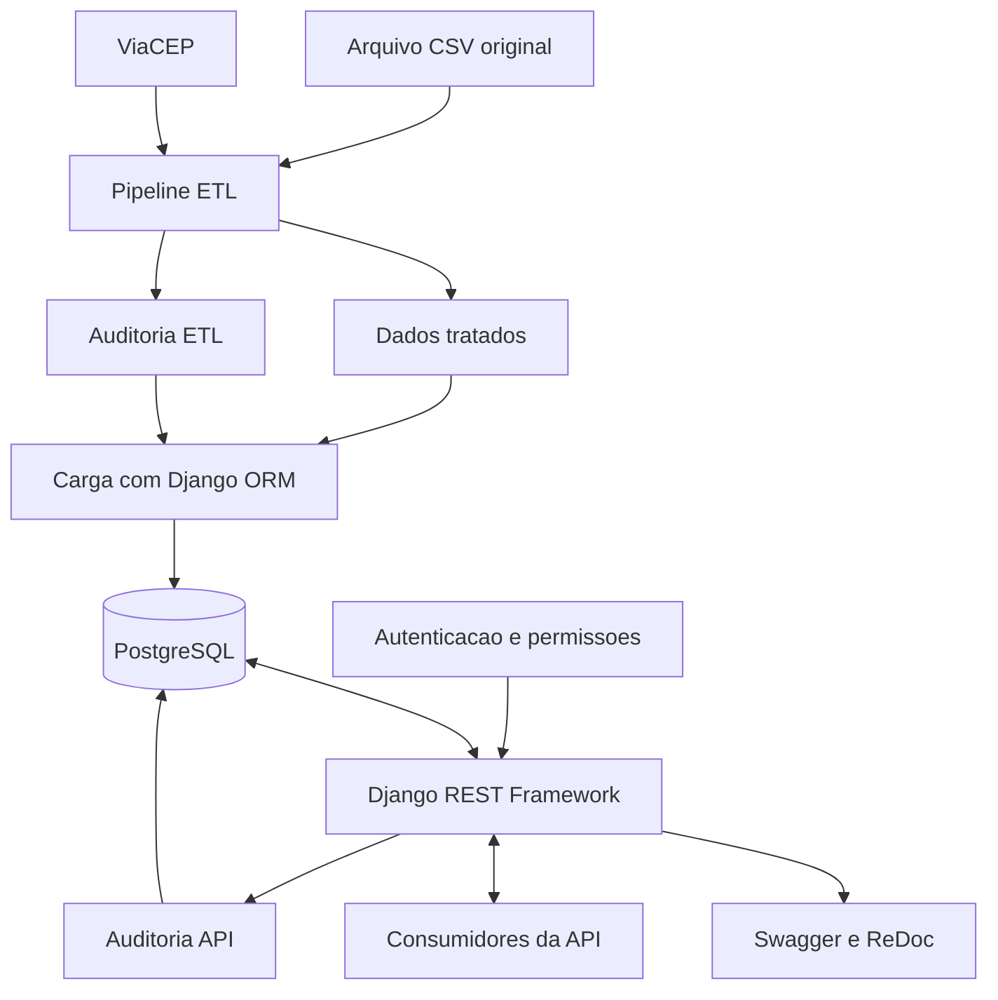

# Arquitetura do Sistema

## 1. Visão geral

O Projeto Primora utiliza uma arquitetura monolítica modular, desenvolvida com Python, Django, Django REST Framework e PostgreSQL.

O sistema é organizado em dois componentes principais: o pipeline ETL, responsável pelo tratamento dos dados, e a aplicação backend, responsável pela persistência, gerenciamento e disponibilização das informações.

## 2. Camada de processamento de dados

O processo ETL realiza a leitura dos arquivos CSV, a aplicação das regras de normalização, o enriquecimento das informações e o registro das transformações realizadas.

## 3. Camada de persistência

O PostgreSQL é utilizado como sistema gerenciador de banco de dados relacional.

O Django ORM permite realizar operações de persistência e consulta utilizando os modelos definidos na aplicação.

## 4. Camada de aplicação

A aplicação backend utiliza Django REST Framework para implementar os endpoints REST, serializers, mecanismos de autenticação, permissões, filtros e paginação.

## 5. Camada de segurança

A autenticação utiliza tokens e sessões do Django. O controle de acesso diferencia usuários de consulta, operadores e administradores.

As informações sensíveis de configuração são armazenadas em variáveis de ambiente.

## 6. Camada de documentação

A documentação da API utiliza o padrão OpenAPI, com interfaces Swagger e ReDoc disponibilizadas pelo drf-spectacular.

## 7. Qualidade e manutenção

O projeto utiliza testes automatizados, separação de responsabilidades, controle de versão com Git e mecanismos de auditoria para contribuir com a qualidade e a manutenção do sistema.

## Entendendo as responsabilidades dos arquivos
|Arquivo            |Responsabilidade                      |
|------------------ |--------------------------------------|
|models.py          |Estrutura e relacionamentos dos dados |
|serializers.py     |Conversão e validação dos dados       |
|views.py           |Processamento das requisições         |
|urls.py            |Definição das rotas                   |
|permissions.py     |Controle de acesso                    |
|services.py        |Serviços de auditoria                 |
|exceptions.py      |Padronização das respostas de erro    |
|pagination.py      |Controle da paginação                 |
|filters.py         |Filtragem dos registros               |
|tests.py           |Testes automatizados                  |
|test_integracao.py |Testes de integração                  |
|admin.py           |Configuração do painel administrativo |
|settings.py        |Configurações gerais do Django        |
|.env               |Configurações locais e credenciais    |
|schema.yaml        |Especificação OpenAPI                 |

## Diagrama da arquitetura

